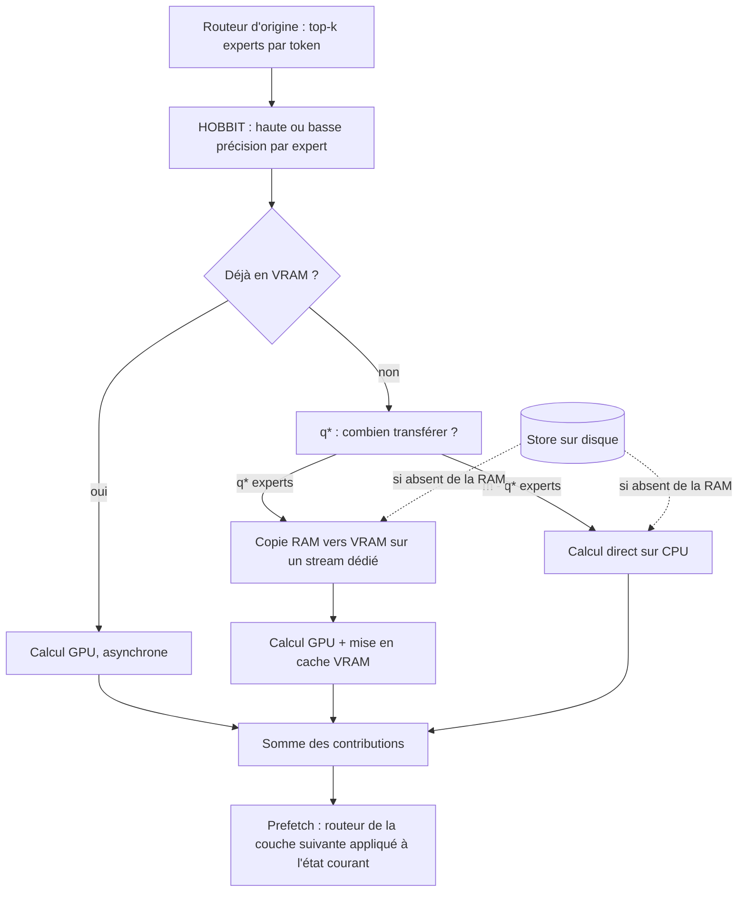

# 09 — Architecture de `moelab`

`moelab` est le système complet construit à partir des étapes précédentes. Il fait
tourner un modèle MoE de transformers en gardant ses experts hors de la mémoire du
GPU, et en décidant à chaque token où et en quelle précision calculer chaque expert.

## L'idée en une phrase

On garde **le routeur d'origine** (il choisit toujours les mêmes experts), mais on
remplace le module qui *contient* les experts par un module qui va les chercher
dans une hiérarchie de mémoire : VRAM, puis RAM, puis disque.

## Les trois niveaux de mémoire

| Niveau | Contenu | Taille estimée (ta machine) | Vitesse d'accès |
|---|---|---|---|
| VRAM (cache rapide) | experts les plus utilisés récemment | ~3 Go libres | calcul GPU immédiat |
| RAM (cache hôte) | le pool int4 complet d'OLMoE + experts fp16 chauds | ~6-7 Go | copie PCIe ~12 Go/s, ou calcul CPU |
| Disque (store) | **tous** les experts, dans toutes les précisions | illimité | NVMe ~2-3 Go/s, HDD ~0,1-0,2 Go/s |

Le store est la **source de vérité** : la place disponible dans les caches ne change
que la vitesse, jamais le résultat pour une précision donnée. C'est vérifié par
`tests/test_equivalence.py` : avec un cache VRAM minuscule (évictions en
permanence) et q* qui envoie des experts sur le CPU, les logits sont identiques à
ceux de transformers.

## Ce qui se passe à chaque couche MoE

Ordre réel dans le code (`MoERuntime.run_layer`), choisi pour que tout se recouvre :

1. décisions de précision (HOBBIT) et regroupement des tokens par expert ;
2. les lectures disque nécessaires partent tout de suite dans un pool de threads ;
3. les experts déjà en VRAM partent en calcul GPU (le GPU travaille en arrière-plan) ;
4. les copies RAM → VRAM partent sur un stream CUDA séparé ;
5. pendant ce temps le CPU calcule sa part (branche q*) ;
6. on attend les copies, on calcule les experts transférés, on les garde en VRAM ;
7. on additionne, puis on lance le prefetch de la couche suivante.

## Correspondance fichiers / concepts

| Fichier | Rôle | Doc |
|---|---|---|
| `moelab/quant.py` | int4/int8 par groupes de 64, FP8 des checkpoints | [10](10-store-et-quantification.md) |
| `moelab/checkpoint.py` | lecture des `.safetensors` tenseur par tenseur | [10](10-store-et-quantification.md) |
| `moelab/store.py` | store sur disque, un record par expert | [10](10-store-et-quantification.md) |
| `moelab/cache.py` | caches VRAM/RAM, LRFU, épinglage, historique | [11](11-cache-lrfu-persistance.md) |
| `moelab/hostpool.py` | mémoire RAM épinglée en slots de taille fixe, bornée | [11](11-cache-lrfu-persistance.md) |
| `moelab/policy.py` | HOBBIT et q* | [12](12-politiques-hobbit-et-qstar.md) |
| `moelab/runtime.py` | exécution d'une couche, prefetch | [12](12-politiques-hobbit-et-qstar.md), [13](13-prefetch-et-mesures-routage.md) |
| `moelab/loader.py` | chargement sans les experts, placement dense | ci-dessous |
| `moelab/plan.py`, `moelab/hw.py` | budgets mémoire, bandes passantes | [12](12-politiques-hobbit-et-qstar.md) |
| `moelab/bench.py` | qualité, vitesse, règle A/B | [14](14-benchmark-ab.md) |

## Le chargement : plus de 12 minutes d'attente

`load_offloaded_model` construit le modèle sur le device `meta` (la structure sans
les poids, instantané), remplace chaque module `experts` par un `OffloadedExperts`,
puis lit depuis le checkpoint **seulement** les poids restants :

| Modèle | Partie dense (fp16) | dont embeddings + tête |
|---|---|---|
| OLMoE-1B-7B | 0,89 Gio | 0,38 Gio |
| Qwen3-30B-A3B | 2,87 Gio | 1,16 Gio |
| Qwen3-Next-80B-A3B | 4,41 Gio | 1,16 Gio |

Placements possibles de cette partie dense : `gpu`, `cpu`, ou `split` (couches sur
GPU, embeddings et tête de sortie gardés en RAM et calculés sur CPU — ils pèsent
lourd mais ne servent qu'une fois par token). `auto` choisit selon la VRAM libre.

## Limites connues (assumées)

- Une synchronisation GPU → CPU par couche (le routage est lu en Python). FreeToken
  l'évite avec des CUDA graphs ; ici on privilégie un code lisible.
- Pas de noyau int4 fusionné : un expert int4 est déquantifié en fp16 avant chaque
  calcul (coût mesuré par le benchmark).
- Familles testées : OLMoE, Qwen3-MoE (même format), Qwen3-Next. Les formats
  d'experts "transposés" ou avec biais (gpt-oss) ne sont pas gérés.
